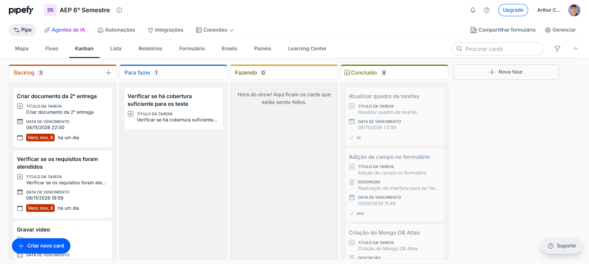

# Cadastro de Candidaturas (Empregabilidade)

## Sobre o projeto

Esta é uma prova de conceito de um sistema de empregabilidade, feita em Java com Spring Boot e MongoDB. A ideia é simples: pessoas que procuram emprego se cadastram, as vagas ficam registradas no sistema e cada pessoa pode se candidatar a uma vaga. Tudo isso é feito por meio de uma API REST.

O problema que o projeto tenta atacar é a dificuldade que muita gente tem de encontrar uma oportunidade de trabalho e de acompanhar suas candidaturas. Por isso o projeto está ligado ao ODS 8, Trabalho Decente e Crescimento Econômico, que fala justamente de promover emprego e aproximar quem procura trabalho de quem oferece.

## Tecnologias utilizadas

O projeto foi feito em Java 17 com Spring Boot, que já traz o servidor Tomcat embutido, por isso não é preciso instalar nenhum servidor à parte. O banco de dados é o MongoDB, que é NoSQL e guarda os dados em documentos. O Lombok foi usado para evitar escrever getters e setters na mão. Para os testes foram usados JUnit 5 e Mockito, e a cobertura de testes é medida com o JaCoCo.

## Como o código está organizado

O código fica em `src/main/java/com/aep/cadastro` e é dividido em camadas. Os controllers recebem as requisições HTTP, os services têm as regras e validações, os repositories conversam com o MongoDB e os models representam os documentos salvos no banco. Existe ainda a pasta exceptions, com os erros do sistema e um tratador que devolve 400 quando os dados enviados são inválidos e 404 quando algo não é encontrado.

```text
cadastro-nosql/
├── pom.xml                     dependências, JaCoCo e regra de 70% de cobertura
├── quadro-de-tarefas.png       quadro de tarefas usado na organização do trabalho
├── src/main/java/com/aep/cadastro/
│   ├── controllers/            Candidato, Vaga e Candidatura (rotas REST)
│   ├── services/               regras de negócio e validações
│   ├── repositories/           acesso ao MongoDB (Spring Data)
│   ├── models/                 Candidato, Endereco, Vaga, Candidatura
│   └── exceptions/             erros do sistema e tratador global (400/404)
├── src/main/resources/application.properties
└── src/test/java/com/aep/cadastro/   testes de services, controllers e exceptions
```

## Estrutura do banco de dados

O banco se chama `cadastro_aep` e tem três coleções: candidatos, vagas e candidaturas.

A coleção de candidatos guarda nome, e-mail, idade e uma lista de endereços. Esse é o objeto complexo do projeto, porque cada candidato tem dentro dele uma lista de subdocumentos, e cada endereço tem rua, cidade e estado. Um documento fica assim:

```json
{
  "nome": "João",
  "email": "joao@email.com",
  "idade": 20,
  "enderecos": [
    { "rua": "Rua A", "cidade": "Maringá", "estado": "PR" }
  ]
}
```

A coleção de vagas guarda o título, a empresa e a descrição da vaga.

A coleção de candidaturas é a que faz o relacionamento entre as outras duas. Cada candidatura guarda o id do candidato, o id da vaga e uma observação. Na hora de criar uma candidatura o sistema confere se o candidato e a vaga realmente existem, e se não existirem devolve erro 404.

Para manter o relacionamento consistente, ao excluir um candidato ou uma vaga o sistema também exclui as candidaturas ligadas a ele, e assim nenhuma candidatura fica apontando para um id que não existe mais.

## Como executar

**1. Instalar e ligar o MongoDB** (local, porta padrão 27017).

No Windows, baixe o MongoDB Community Server (instalador `.msi`) no site oficial da MongoDB e instale mantendo marcada a opção "Install MongoDB as a Service". O MongoDB Compass, que é a interface gráfica do banco, pode ser instalado junto. Depois da instalação o serviço já fica rodando. Para conferir, abra o PowerShell e rode `Get-Service MongoDB`, que deve mostrar o estado Running. Se estiver parado, rode como administrador `net start MongoDB`. No Linux, o comando para iniciar é `sudo systemctl start mongod`.

Para ter certeza de que o banco está respondendo, abra o Compass e conecte em `mongodb://localhost:27017`.

**2. Iniciar a aplicação.** Com o JDK 17 ou superior instalado, abra um terminal na pasta do projeto e rode `./mvnw spring-boot:run` (no Windows, `mvnw.cmd spring-boot:run`). A API fica disponível em `http://localhost:8081`. O banco e as coleções são criados sozinhos assim que o primeiro registro é salvo.

**3. Conferir se subiu.** Abra `http://localhost:8081/actuator/health` no navegador. A resposta `{"status":"UP"}` indica que a aplicação está de pé e conectada ao MongoDB.

Por padrão a aplicação conecta em `mongodb://localhost:27017/cadastro_aep`. Se for preciso usar outro endereço, basta definir a variável de ambiente `MONGODB_URI`.

## Como usar a API

Não existe senha nem autenticação. As requisições podem ser feitas pelo Postman, escolhendo o método HTTP e, quando for preciso, enviando o corpo em JSON (`Body > raw > JSON`).

| Recurso | Rotas |
|---|---|
| Candidatos | `GET /api/candidatos`, `GET /api/candidatos/{id}`, `POST /api/candidatos`, `PUT /api/candidatos/{id}`, `DELETE /api/candidatos/{id}` |
| Vagas | `GET /api/vagas`, `GET /api/vagas/{id}`, `POST /api/vagas`, `PUT /api/vagas/{id}`, `DELETE /api/vagas/{id}` |
| Candidaturas | `GET /api/candidaturas`, `GET /api/candidaturas/{id}`, `GET /api/candidaturas/candidato/{candidatoId}`, `POST /api/candidaturas`, `PUT /api/candidaturas/{id}` (altera só a observação), `DELETE /api/candidaturas/{id}` |

Códigos de resposta: 200 (sucesso), 201 (criado), 204 (excluído), 400 (dados inválidos) e 404 (não encontrado).

Uma sequência boa para testar:

1. `POST /api/candidatos` com o corpo do exemplo da seção do banco de dados. Copie o `id` que voltar.
2. `POST /api/vagas` com `{"titulo": "Desenvolvedor Java", "empresa": "Tech Ltda", "descricao": "Desenvolvimento de APIs"}`. Copie o `id` que voltar.
3. `POST /api/candidaturas` com `{"candidatoId": "<id do candidato>", "vagaId": "<id da vaga>", "observacao": "Tenho interesse na vaga"}`. Deve voltar 201.
4. `GET /api/candidaturas/candidato/{id do candidato}` lista as candidaturas dele.
5. `PUT /api/candidaturas/{id}` com uma nova observação, e depois `DELETE` para excluir.
6. Testar os erros: criar uma candidatura com `vagaId` inexistente (404) e um candidato sem nome ou com e-mail sem `@` (400).

O resultado também pode ser conferido direto no MongoDB, pelo MongoDB Compass ou pelo `mongosh`.

## Testes e cobertura

Os testes ficam em `src/test/java` e cobrem principalmente os services, que concentram as regras de negócio, as validações e o relacionamento entre as coleções. Eles usam Mockito no lugar do banco, então não precisam do MongoDB ligado e não mexem em nenhum dado real.

Para rodar os testes e conferir a cobertura, use `./mvnw verify` (no Windows, `mvnw.cmd verify`). O relatório do JaCoCo é gerado em `target/site/jacoco/index.html`, e o próprio Maven faz o build falhar se a cobertura de linhas ficar abaixo de 70%.

## Evolução em relação à primeira entrega

Na primeira entrega o sistema tinha uma única coleção, com os dados do candidato e da vaga misturados num mesmo documento. Agora são três coleções separadas, com relacionamento entre elas por meio dos ids, e o candidato passou a ter uma lista de endereços aninhada. Também foram corrigidos erros que existiam, como a senha do banco escrita no código, e os testes deixaram de depender de um banco real. Por fim, a exclusão de candidatos e vagas passou a remover as candidaturas relacionadas, para não deixar dados órfãos.

## Versões das entregas

| Entrega | Tag no GitHub |
|---|---|
| Primeira entrega | `v1.0-entrega1` |
| Segunda entrega (versão final) | `v2.0-entrega2` |

O código de cada entrega pode ser visto na aba Tags (ou Releases) do repositório no GitHub, escolhendo a tag correspondente.

## Metodologia de trabalho

O desenvolvimento foi organizado com um quadro de tarefas, apresentado na imagem abaixo.

Link PipeFy: https://app.pipefy.com/public/form/QKn6QGmQ



